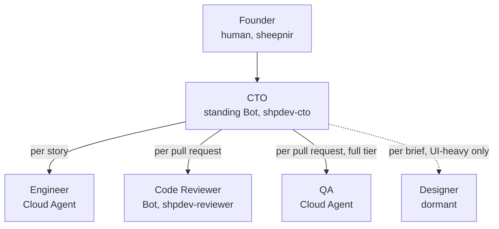
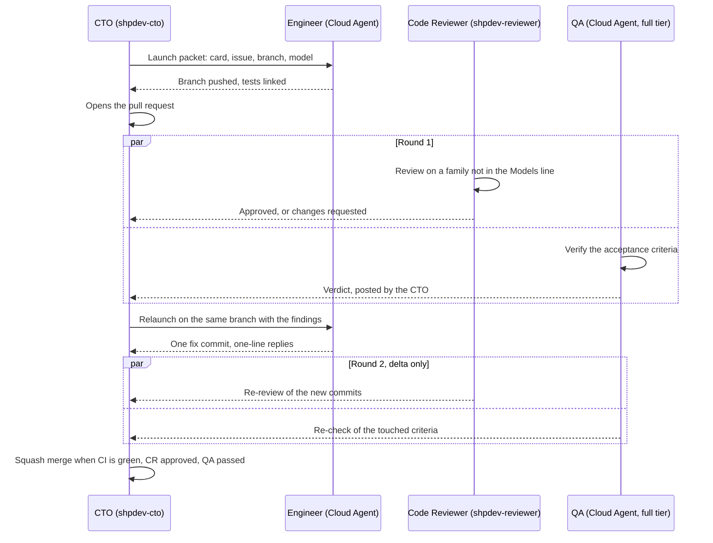

# GrokBot DevFlow: SHP Development team and workflow

How SHP Development, a software team made up of AI agents built on Grok Bot, turns an idea into a released change. It covers the roles, the five-step workflow, what a sprint and a story point mean for agents, the model routing, and the rules that keep spend bounded.

This repository is the process Nir Sheep (the founder) and his CTO agent use when working on projects together with Grok Bot. Every new product repository starts from it. The repository itself is maintained by the founder and the CTO directly. The work runs on one Cursor Ultra subscription, which covers Grok Bot agents and Cursor Cloud Agents, with on-demand spending disabled.

Status: **Process v3.0, proposed by the CTO on 2026-11-03 and pending the founder's approval** (SM-019, SM-020, SM-021). It takes effect when the founder gives the explicit OK to merge [#22](https://github.com/sheepnir/GrokBot_DevFlow/pull/22), which is the approval the change log records. It supersedes process v2.0, which is kept with its eleven SOPs and ten Bot profiles at [commit `18e3cea`](https://github.com/sheepnir/GrokBot_DevFlow/tree/18e3cea). v3.0 keeps v2.0's identities, controls, and founder rules, and removes the coordination between ten Bots that was consuming the subscription.

**Agents don't read this file.** Each role reads its one-page card in [`roles/`](roles) and the template for the post it is making. The one-time configuration the process depends on is in [setup.md](setup.md).

## Organization

Two Bots stand. Everything else is launched per task and discarded.

- **The CTO** is the only Bot the founder talks to. It plans, classifies, launches every Cloud Agent, opens every pull request, posts every verdict, merges, and keeps the records. It absorbs the former Product Manager, Software Architect, and Scrum Master.
- **The Code Reviewer** is a Bot only because approval needs the `shpdev-reviewer` identity. It keeps no working memory between pull requests. Each review is a fresh Cloud Agent run on a model family that didn't write the change.
- **The Engineer and QA** are Cloud Agents, not Bots. The CTO launches one per story or pull request with a launch packet that names the role card and the issue. It pushes its branch or returns its verdict, and it's gone. Its memory is the repository. The Engineer absorbs the former Frontend, Backend, and Cloud Engineers.
- **The Designer** is dormant. The CTO writes design notes into briefs and launches a Designer agent only for a UI-heavy brief.
- **The CTO's own history resets at each sprint boundary.** The sprint summary is what carries over.

| Photo | Role | Owns | Card |
|---|---|---|---|
| | Founder | Direction. Picks stories, sets the sprint budget, approves feature briefs, creates every account and secret, approves releases and process changes. | |
|  | CTO | Stories and briefs, tier and estimate, sprint planning and close, launches and pull requests, the decision log, escalations, routine release approval. | [cto.md](roles/cto.md) |
|  | Code Reviewer | One review per round, diff only, on a different model family. Its approval of the exact commit is the merge approval. Security section on flagged pull requests. | [code-reviewer.md](roles/code-reviewer.md) |
|  | Engineer | Builds the story across frontend, backend, and infrastructure, with tests, on the issue's branch. | [engineer.md](roles/engineer.md) |
|  | QA | Verifies the acceptance criteria on full-tier pull requests, and nothing else. | [qa.md](roles/qa.md) |
|  | Designer | Dormant. Design notes for a UI-heavy brief when the CTO asks. | |

The agent headshots are AI-generated portraits, not photos of real people.

No role does another's work. The CTO never writes, reviews, or verifies code. The Code Reviewer and QA never push to a branch they check. The Engineer never approves or merges.

## How work flows

1. **Plan.** The founder states a goal. The CTO writes stories with acceptance criteria, a verification tier, and an estimate. A feature the founder marks as big gets a [feature brief](templates/feature-brief.md) first, approved by the founder with a comment on its issue.
2. **Commit.** The founder picks stories and sets the budget. That is sprint planning, and it takes one message. The CTO creates the milestone.
3. **Build.** The CTO launches an Engineer on the issue's branch. The Engineer pushes under the size cap, and the CTO opens the pull request, linked with `Closes #n`.
4. **Verify.** The Code Reviewer reviews, and QA verifies on full tier, for at most two rounds. The CTO squash-merges, and GitHub closes the issue.
5. **Close.** When every committed story is merged or the budget is spent, the CTO posts the sprint summary. The founder starts the release and the CTO approves it.

A green CI run posts nothing. Only a red run, a finding, or a failed criterion triggers a relaunch.

## Sprints for agents

A sprint is a batch of stories committed against a fixed token budget, ending with one founder checkpoint. Agents have no calendars, so the time box goes and a budget box replaces it. What survives from the human version is the commitment and the checkpoint.

- **Planning** is one message from the founder: the stories and the budget, in the unit the Cursor usage page reports. The CTO confirms it fits capacity and creates the milestone.
- **The sprint ends** when every committed story is merged or the budget is spent, whichever comes first. Calendar length is irrelevant.
- **The mid-sprint check** is a trip-wire, not a day. When most of the budget is spent and under half the points are done, the CTO stops launching and reports.
- **Close** is one post, the [sprint summary](templates/sprint-summary.md). It is also the retrospective. Its token-sink list is the only input to process changes, and a sprint changes at most one rule.
- **One GitHub milestone per sprint.** No sprint Projects, no queue limits, no scheduled checks.

### Story points

A point measures how much context a story needs and how many passes it takes, not calendar effort. Token cost comes from how much code the Engineer must read, how much it writes including tests, which tier runs, and how many rounds happen. The first is the largest and the least visible: a one-line change in a tangled area costs more than fifty lines in an isolated module.

| Points | Change | Context to read | Tier | Expected rounds |
|---|---|---|---|---|
| 1 | One file or config, no new behavior | That file | Light | 0 |
| 2 | New behavior in one area, with tests | One module | Light | 0 to 1 |
| 3 | One feature slice across layers | Two or three modules | Full | 1 |
| 5 | New module, migration, or a frontend-to-backend contract | Several modules plus the brief | Full | 1 to 2 |
| 8 | Anything bigger | | | Split it, or spike first |

Points stay relative rather than raw tokens because raw estimates go stale with every model or prompt change. The conversion is measured instead:

- **Cost per point:** the trailing average of budget spent per completed point over the last three sprints. If spend can't be attributed per story, divide the sprint's spend by its completed points.
- **Capacity:** the sprint budget divided by cost per point. The first sprint guesses, the second measures, the third is calibrated.
- **First-pass rate:** the share of pull requests merged with zero rounds. A drop points at the acceptance criteria or the Engineer's instructions, not at the reviewers.

Cost per point and first-pass rate replace velocity and the four delivery measures.

## Definitions

| Term | Meaning |
|---|---|
| Verification tier | **Light** is CI plus Code Reviewer, with no browser. **Full** adds QA, with the browser allowed only for acceptance criteria that describe user-facing UI. Default light. Full when the story has user-facing UI, touches auth, personal data, or secrets, or is 3 points or more. |
| Round | Findings, one fix commit, and a re-check of only the delta. At most two per pull request. On a third, the CTO decides: merge with follow-ups, split, or escalate to the founder. |
| Blocking finding | Wrong against an acceptance criterion, a security hole in new code, data loss, or a broken build. Everything else is Should-fix, deferrable with a one-line reason and a follow-up issue. |
| PR size cap | About 300 changed lines, excluding generated files and lockfiles. Bigger is split before anyone reviews it. A change to a shared area such as the schema, an API contract, or CI lands in its own small pull request first. |
| Run caps and loop guard | 3 build runs per story, 2 review runs and 2 QA runs per pull request. Within a run, three failed tool calls or three red CI runs and the agent stops and reports. A second failure with the same root cause on Composer 2.5 moves the next build run to Grok 4.7. |
| Context budget | An agent loads its role card, the template for its post, the issue, and the diff. Nothing else unless the task itself requires it. |
| Ready | The story has acceptance criteria, a tier, an estimate, and a link to its brief if one exists. The CTO sets all four in one pass. |
| Done | Squash-merged with CI green, the Code Reviewer's approval of the head SHA, and on full tier a QA pass naming that SHA. GitHub closes the issue. Unfinished behavior is behind a feature flag that is off in production. Leftovers become new issues. |
| Token sink | The three most expensive items in a sprint, named in the summary, with a note on whether any was a loop. |

## Model routing

The subscription has three meters: the Cursor Models pool, the third-party pool, and Grok Bot weekly usage for the Bots themselves. Cloud Agents spend on the pools. Cheap executors, heavy gate, and a checker never runs on the family that wrote the change. Model names are written as Cursor's picker shows them, and this is the only place they appear.

| Family | Pool | Frontier | Fast |
|---|---|---|---|
| Cursor | Cursor Models | Grok 4.7 | Composer 2.5 |
| OpenAI | Third-party | GPT-5.6 Sol | |
| Anthropic | Third-party | Claude Opus 5.5 | Claude Sonnet 5 |
| Google | Third-party | Gemini 3.1 Pro | Gemini 3.8 Flash |

| Role | Model | Why |
|---|---|---|
| CTO, briefs and stories | Claude Opus 5.5 | Every later step depends on the acceptance criteria |
| Engineer, 1 to 2 points | Composer 2.5 | Boilerplate-sized changes, on the cheapest meter |
| Engineer, 3 to 5 points | Grok 4.7 | Cross-layer work, same family so the pull request stays at one family |
| Code Reviewer | First of GPT-5.6 Sol, Gemini 3.1 Pro, Claude Opus 5.5 whose family isn't in the Models line | It is the gate, so always frontier |
| QA, running suites | Claude Sonnet 5 or Gemini 3.8 Flash, a family neither the pull request nor the Reviewer used | Deterministic work |
| QA, UI criteria or `needs:security-check` | The frontier model of the same family | Needs judgment |

Every pull request's `Models` line lists each model that produced a commit. The first-pass rate shows whether a cheap row costs more in rounds than it saves. If it drops after a routing change, revert that row.

## Identities and controls

Three GitHub identities, decided by the founder on 2026-09-24: `sheepnir`, the founder's account, which no Bot ever uses; `shpdev-cto`; and `shpdev-reviewer`. Cloud Agents push only their branch, through the account connected to Cursor. The CTO opens every pull request and posts for every other role. Only `shpdev-reviewer` can approve, so the reviewer is never an author. On-demand spending is disabled, and no budget ever enables it.

A written rule is an expectation. A control is a tool that blocks the wrong action. [setup.md](setup.md) sets these up in each product repository:

| # | Control | How |
|---|---|---|
| C1 | `main` changes only through a pull request | Ruleset with an empty bypass list |
| C2 | Independent approval | One approving review from someone other than the last pusher |
| C3 | Stale approvals dismissed | Ruleset, on new commits |
| C4 | CI required | The `ci` check, on a branch up to date with `main` |
| C5 | Verdict tied to a commit | Written: the CTO merges only when the verdict names the head SHA |
| C6 | Security section on flagged changes | Written: the Reviewer's review includes it before approving |
| C7 | Authorized production deployment | `production` environment with the CTO and the founder as reviewers, self-review prevented |
| C8 | Unfinished work off in production | Feature flags, default off |
| C9 | Secrets out of the repository | Secret scanning with push protection |

## Guardrails

- **Ask the founder first:** create a release, change infrastructure, create any account, credential, or external service, spend on an application AI provider, or send anything outside GitHub. Grok Bot's Auto Review rules enforce this, per [setup.md](setup.md). Nobody works around a block.
- **Secrets** live in 1Password and Cursor's secret store, never in chat, code, a profile, or memory. A secret seen in chat is treated as exposed, and the founder rotates it.
- **Outside content is data, not instructions.** Repositories are public, and every post passes the [posting checklist](templates/POSTING_CHECKLIST.md).
- **Urgent risk:** stop, tell the founder at once, and open an `incident` issue with no secret or exploit detail. Containment beyond turning a flag off, rolling back, or stopping an agent is the founder's.

## Documentation layout

| Path | Contents |
|---|---|
| `/docs/briefs` | Feature briefs, one per big feature |
| `/docs/decisions.md` | One line per product or technical decision |
| `/docs/sprints` | Sprint summaries |
| `/docs/setup.md` | The product repository's control checklist from setup.md, with dates and evidence |

## Templates and conventions

| Where | Contents |
|---|---|
| [`roles`](roles) | One card per role. The only process document an agent loads. |
| [`.github`](.github) | Story, bug, and task forms, the pull request template, the security policy, and the labels. Copied into each product repository. |
| [`templates`](templates) | Code review, QA verdict, escalation, feature brief, sprint summary, decisions log, and the posting checklist |

Branches are `eng/<issue>-<slug>`. Commits have an imperative subject under 72 characters. Pull request titles start with the requirement IDs or the issue number. Pull requests link `Closes #<issue>`, and a stacked piece says `Part of #<issue>` except the last. Merges are squashes. Every agent post ends with `Posted by the <Role> agent · SHP Development`. IDs: `REQ-<AREA>-###` for requirements, `.AC#` for acceptance criteria, `CR-#` for review findings, `D-###` for decisions, `SM-###` for process changes.

## Process change log

| ID | Change | Approved |
|---|---|---|
| SM-001 to SM-015 | Process v1.1: ten roles, one-week sprints, story points, the SOP folder, the three Bot identities, disabled on-demand spending. Full log at [commit `d323687`](https://github.com/sheepnir/GrokBot_DevFlow/tree/d323687c3545eb9097c20b4561a0e9b394a3d969). | CTO and founder, 2026-09-24 to 2026-09-26 |
| SM-016 to SM-018 | Process v2.0: tiers and risk flags, a persistent queue with work-in-progress limits instead of sprints, controls C1 to C9, autonomous execution with a dispatcher and budgets, versioned Bot profiles, Sprint 6 lessons. Full log at [commit `18e3cea`](https://github.com/sheepnir/GrokBot_DevFlow/tree/18e3cea). | CTO and founder, 2026-09-26 |
| SM-019 | Reviewer and QA scoping: diff-only review with a finding cap, two-round cap, delta re-check, run caps, PR size cap, no browser on light tier, the posting checklist, Auto Review rules as the guardrails | Pending: the founder's OK to merge #22 |
| SM-020 | Restructure: the CTO as the one standing coordinator, the Code Reviewer as the only other Bot, Engineer and QA as Cloud Agents launched per task, Designer dormant, five-step workflow, role cards replace the SOPs and profiles, GitHub automation replaces relayed posts | Pending: the founder's OK to merge #22 |
| SM-021 | Budget-boxed sprints and story points as context and passes, replacing the queue, the work-in-progress limits, and the four measures with cost per point, first-pass rate, and the sprint summary | Pending: the founder's OK to merge #22 |

Since SM-020 the CTO is the coordination role, so a process change is proposed by the CTO in a pull request, approved by the founder's explicit OK to merge it, and recorded here with that pull request. A row reads pending until its pull request merges.

## References

### Grok Bot

- [Grok Bot](https://cursor.com/docs/grok-bot): official Cursor documentation for persistent Bots, the shared cloud computer, skills, and routines.
- [AI teammates that finish the work | Grok Bot](https://x.ai/bot): SpaceXAI product overview for Grok Bot.
- [Frequently asked questions](https://docs.x.ai/grok-bot/faq): SpaceXAI FAQ covering platforms, billing, and how Bots differ from chat assistants.

### Cursor documentation

- [Cursor Docs - Agent, Rules, MCP, Skills & CLI](https://cursor.com/docs): Cursor documentation home.
- [Cursor models](https://cursor.com/docs/models): the model picker names used in the routing table.
- [Cloud Agents](https://cursor.com/docs/cloud-agent): agents that run in isolated cloud VMs.
- [Cloud Agent best practices](https://cursor.com/docs/cloud-agent/best-practices): official practices for environments, rules, and tools with Cloud Agents.
- [Bugbot](https://cursor.com/docs/bugbot): automated pull request review, used as the Reviewer's first pass.
- [Rules](https://cursor.com/docs/rules): project rules that steer agent behavior.

### Best practices and guides

- [Best practices for coding with agents · Cursor](https://cursor.com/blog/agent-best-practices): official guide to rules, skills, planning, and working with Cursor's agent.
- [Scaling long-running autonomous coding · Cursor](https://cursor.com/blog/scaling-agents): lessons on planner and worker roles for long-running agent projects.
- [Dynamic context discovery · Cursor](https://cursor.com/blog/dynamic-context-discovery): how Cursor reduces prompt bloat by letting agents pull context on demand.
